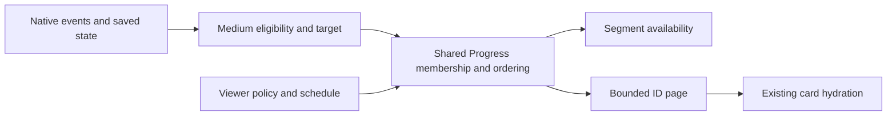

# Coast Progress logic audit

**Baseline** `1d53ea895` on main, 19 November 2026. Scope includes Film & TV, games, music, books and comics, with the Continue hero, For You, profile Watching, expanded shelves, Library, Collection, detail cues, and API reads. Four cross-surface cases were reproduced in disposable PostgreSQL 17 fixtures. The proposed contract is an implementation plan.

## Findings and priorities

| Priority | Finding | Evidence and impact |
| --- | --- | --- |
| High | **A dropped game can remain in Next while disappearing from Dropped.** | Reproduced with a dropped playthrough and an explicit queue entry. Mixed Next admits it because the exclusion covers only in-progress and paused games. Profile Dropped uses Collection’s personal seed set, where the default Collection preference hides dropped reasons. Explicitly collecting the game makes it appear in Dropped while it stays in Next. Progress status should be independent of which reasons surface in Collection. [Game admission](../../src/lib/server/queries/progress.ts#L431) · [Mixed history](../../src/lib/server/queries/progress-experiment.ts#L22) · [Collection suppression](../../src/lib/collection/query.server.ts#L131) |
| High | **A queue-only book is admitted by one Next and skipped by another.** | Reproduced with an `up_next` relationship and no reading row. Mixed Next and Library use `readingProgressIds(..., false)`. The per-medium read sets `includeSaved=true`, which adds the watchlist but also disables its explicit queue branch. Normal reading menus currently lack the generic queue control, so the fixture establishes the underlying contract drift. Queue and watchlist policy need separate inputs. [Reading eligibility](../../src/lib/server/queries/progress.ts#L209) · [Library segments](../../src/lib/server/queries/library-segments.ts) · [Catalogue actions](../../src/lib/ui/work-menu/CatalogueActions.svelte#L266) |
| High | **Finished and Dropped can depend on unrelated visibility and broader Collection logic.** | Mixed history starts with Collection’s personal evidence. Its screen results use `libraryTrackingCondition`, while game completion and drops in the shared assessment are gated by Activity visibility. Mixed Progress applies Progress visibility afterward. The legacy screen read has its own roots, status predicates, view recency and counts. Establish an explicit Progress policy and derive history status from the medium owner with the intended visibility, using separate rules for Activity. [Collection status](../../src/lib/collection/query.server.ts#L226) · [Mixed history](../../src/lib/server/queries/progress-experiment.ts#L22) · [Profile queries](../../src/lib/server/queries/profile.ts#L503) |
| High | **There are several definitions of the next episode.** | Reproduced with one watched, aired episode followed by an undated one. Progress correctly excluded the latter. Collection’s `nextId` and the show-detail focus still chose it. Detail episode lists should retain upcoming and undated entries. The audit identifies an opportunity to distinguish a browse position, an eligible Progress target and a playable target, each with an explicit contract. Collection uses base release dates and raw child state, while Continue plans with effective airtime, rewatch state and parent pause/drop gates. Sequence membership uses the date-only helper and mixed Progress then filters the selected target again. If a sequence planner first chooses a candidate that the final gate excludes, an eligible following entry can be missed. [Collection episode selector](../../src/lib/collection/query.server.ts#L213) · [Detail anchor](../../src/lib/server/queries/show-next.ts#L19) · [Continuation planner](../../src/lib/server/queries/continuations.ts#L66) · [Sequences](../../src/lib/core/lists/sequence.server.ts) |
| High | **A reader heartbeat can change Continue order without movement.** | Reproduced on PostgreSQL by applying the timestamp-only write performed by a heartbeat. An older EPUB moved ahead of a more recently advanced book with the bookmark unchanged. Opening a session may also copy a bookmark into a newly timestamped session. Use a position-change clock for Continue and a separate session clock for active reading. [Reading recency](../../src/lib/server/queries/progress.ts#L35) · [Bookmark copy and heartbeat](../../src/lib/reading/sessions.server.ts#L136) · [Visible reader heartbeat](../../src/lib/reading/Reader.svelte#L42) |
| Medium | **Music has native resume and queue paths but a different Progress surface.** | Mixed Progress excludes music in the schema, SQL, and shelf. For You’s Listen view shows Music library and saved shelves, while the per-medium API can return positioned tracks. Album resume and completion are handled by Collection and music queue owners. Decide explicitly whether Listen gets its own Continue and Next or adds a music adapter to the mixed model. Track, album and artist roles still need different actions. [For You Listen](../../src/routes/for-you/+page.svelte#L48) · [Mixed query](../../src/lib/server/queries/progress-experiment.ts#L53) · [Music queue](../../src/lib/music/queue.server.ts) |
| Medium | **Saved intent, current tracking state and history are mixed differently.** | Mixed Next separates Later and avoids watchlist-only candidates. The legacy explicit `next` can include saved screen titles, and the legacy games and reading readers can include watchlist intent differently. Screen queue entries are consumed on accepted progress or completion, including scoped parents. Equivalent game and reading writes have separate owners and do not share that rule. Finished screen/card summaries also distinguish aired totals from whole-catalogue completion in different places. [Screen progress selection](../../src/lib/server/queries/progress.ts#L297) · [Video queue consumption](../../src/lib/core/tracking/service.server.ts#L285) · [Game mutations](../../src/lib/core/games/service.server.ts#L126) · [Reading mutations](../../src/lib/core/reading/service.server.ts#L67) |
| Medium | **One work can have several activity clocks.** | Screen Continue largely uses known, accepted viewing events and the rewatch boundary, often at show scope. Next in the mixed view applies work or queue recency; the legacy screen read retains candidate ordering. Games use the latest-created playthrough and its edit time, so a newly logged backdated session can bump a game. Music uses the saved track state. Screen position thresholds also differ by consumer. Choose clocks per view, and make receipt time, event time, session heartbeat and relationship changes explicit. [Viewing recency](../../src/lib/server/queries/viewing-recency.ts) · [Mixed ranking](../../src/lib/server/queries/progress-experiment.ts#L83) · [Game logging](../../src/lib/core/games/service.server.ts#L172) · [Playback persistence](../../src/lib/playback/service.server.ts#L708) |
| Medium | **Summary and page readers still have their own refresh and filtering boundaries.** | Both shelf sources use the same resource and segment UI but independently own selection, per-tab preferences, summary epochs and fallback. Mixed `availableViews` is intentionally unfiltered by kind/availability; its selected page can be empty after applying filters. The mixed source revalidates on tracking and social revisions, with no dedicated clock boundary for an episode airing while the view stays open. The shared contract should state which underlying scopes and changes invalidate a summary or page. [Mixed shelf owner](../../src/lib/ui/shelves/progress-experiment.svelte.ts) · [Per-medium shelf owner](../../src/lib/ui/shelves/progress.svelte.ts) |

## What is shared and what is native

| Medium | Native state and evidence | Shared use and remaining bespoke rules |
| --- | --- | --- |
| Movies | `tracking_state`, accepted `tracking_events`, optional edition position, explicit watch/unwatch and drop/pause flags. Playback can write progress or completion. Rewatches overlay a dated boundary. | The screen planner, event recency and logical predicates are reused across several surfaces. Continue chooses partial positions or a current rewatch with medium-specific thresholds. Library status, mixed history and player launch still own related predicates. |
| Shows, seasons, episodes and screen collections | Same tracking records plus parent relations, alternate sequence membership, special flags, schedule and inherited rewatch scope. | `continuationIds`, `screenProgressPlan` and sequence helpers provide substantial reuse. Continue may display an episode under its show. Next can show a season or its first eligible episode by surface, and a collection can retain contextual member identity. Library rolls candidate children up to the root. Collection and detail focus have independent choices. |
| Games | `game_playthroughs` and dated `game_sessions`. Latest created playthrough determines current status. Progress percent, session time, completion, replays and Steam observations are distinct. | Mixed and native Continue reuse game selection and recency helpers. Paused, Library and Collection separately select the latest playthrough. Finished and Dropped go through Collection for mixed history, while the legacy game Progress endpoint rejects those views. An intentionally started game may be in Continue at zero percent because starting a run is evidence. |
| Music | Saved track seconds/duration plus dated listens and play counts. A selected album edition, track order and verified membership carry album context. Artists aggregate ordered tracks but have no native seek position. | Native track Continue exists. Mixed Progress intentionally excludes music today. The audio queue and Collection assess which track to resume and whether an album is complete. Track position reset preserves listens. A paused player session has different meaning from pausing tracking. |
| Books and comics | Shared `reading_progress` state and page counts, reading history and an edition-specific page or EPUB CFI bookmark in the current cycle. Rereads have an explicit restoration snapshot. | They share the same reading write owner, bookmark fence and mixed/native resume predicate. Reader format and local file permissions vary by edition. Clearing position rotates the cycle and removes Continue eligibility while retaining state and history. A first-page or EPUB location at zero fraction is valid. Collection’s Reading status can still include an item with no resumable position. |

**Shared today.** The app already has a canonical work ID, existing `up_next`, saved relationships, category and social authorization, current screen planning, shared game and reading candidate helpers, one Paused page owner, card presentation, pagination and Svelte request lifecycle primitives. The useful split is between medium-native evidence and shared read decisions. There is substantial reuse inside each responsibility and no single owner across the complete path from a write to a segment.

**Keep medium rules where the evidence differs.** Video position, EPUB anchors, game percent and listen completion should retain their native units. A game session log is meaningful at zero percent, while a cleared page with no bookmark should leave Continue. Steam ownership and activity cannot prove a game is installed, completed or in a local playthrough. For an album, only a verified, ordered edition can establish its actual member sequence. Coast can track manually without a playback integration. [Data schema](../../src/lib/server/db/schema.ts) · [Music persistence](../../src/lib/music/persistence.server.ts) · [Reader position commands](../../src/lib/core/reading/service.server.ts) · [Steam observations](../../src/lib/providers/steam/sync.server.ts)

## Proposed unified contract

Use **one Progress read service** with a small per-medium evidence adapter. Build each row from work ID, current state, target ID/type, ordering evidence, access capability and the applicable owner/viewer policy. Keep native history and commands in their existing owners. One result should be able to serve segment availability, preview, expanded page and root membership for Library, with the caller choosing its presentation and scope.

| Decision | Proposed rule |
| --- | --- |
| Continue | A valid resume position, a deliberately started run, or the next eligible item inside an already-started sequence. A real zero-position bookmark can qualify. A reset removes stale resume evidence and retires the old cycle or equivalent marker. Preserve Paused and Dropped as explicit current states. |
| Next | An explicit queue item, a deliberately planned native state or the next eligible boundary of an in-progress sequence. Use one queue policy independent of Later. Resolve whether an explicit user action reactivates a dropped or finished work at mutation time. Avoid leaving a stale queue entry as the only reason a dropped work shows up. |
| Paused and Dropped | Reflect the current run or explicit tracking intent. Preserve saved position and prior activity. A paused media transport, buffer state or hosted party state is a separate concern. Use the same eligibility for segment summary and selected-page membership. |
| Finished and history | Use one agreed definition of logical completion of the current work or run. Preserve lifetime completions and past runs in History. Decide how rewatch and replay affect the current Finished tab and how a running show with all aired episodes watched should appear. Keep `caught up`, current-run completion and full catalogue completion distinct internally. |
| Eligibility and availability | Keep media feature gates, content policy, privacy, schedule and playability as independent predicates. A tracker can display an aired item without a connected file source. An Available filter applies viewer-specific evidence. A detail browse list may display an upcoming episode without making it the next Progress recommendation. |
| Clocks | Carry `progress changed`, `occurred`, `queued`, `completed`, `dropped` and `observed` timestamps where used. Rank Continue by meaningful position or run activity, Next by explicit queue/order policy, and Finished by completion date. Use a stable work ID tie-breaker. Rebuild the current result when its relevant revision or nearest known airtime boundary changes. |
| Segments and caps | Use a common registry of segment labels and supported contexts. Reuse one existence query over the same admitted relation for each segment’s broad availability. Let filters produce a genuine empty selected page. Retain 20-card mixed previews and 60-card expanded/native pages, with privacy and membership before counts and pagination. |

## Implementation order

1. **Write the shared behaviour tests before changing reads.** Encode the reproduced cases and agreed intentional differences. Add privacy fixtures that vary Progress, Activity and Collection independently. Test queue-only, dropped, completed, pause/resume, resets, rewatches, rereads, unknown air dates, schedule corrections, backdated sessions, zero-page bookmarks, missing duration, disabled mediums and unavailable playback. Preserve native write idempotency, active session fences and history.
2. **Extract shared admission and clocks from existing helpers.** Start with screen eligibility and game/reading Continue/Next. Split `includeSaved` into explicit inputs. Give Progress completion and drop a direct status candidate path. Separate a saved bookmark’s change time from its reader session heartbeat. Introduce a stable choice of current game run while leaving historical entries intact.
3. **Use the same candidates for summaries, row/grid and Library.** Keep existing list/sequence ordering context. Decide per caller whether the card shows a root or member, including upcoming detail navigation, without changing the eligible entity behind it. Preserve public API shapes through the existing route adapters and compare complete ordered results before swapping consumers.
4. **Define music parity deliberately.** Start with track Continue and an explicit ordered album/queue target. Add an album Finished projection only when the edition membership and track history support it. Keep artist navigation, ‘paused playback’ and click-to-resume separate from tracking states that a user hasn’t chosen.
5. **Switch bounded reads in stages and measure.** Compare result IDs, order, privacy and segment counts under the same fixtures and data. Check response size, hot SQL plans, cancellation, DB query count, row refresh during long scroll and activation around release time. Keep the 20/60 hydration budgets, no remote calls in Progress, and no extra hydration or retry loop for an empty tab. [Coast performance guidance](../performance.md#query-scope-projection-and-exact-reuse)

## Verification

The linked owners were traced from the current route, API or menu to membership and storage. A disposable PostgreSQL 17 probe executed the real mixed, per-medium, Collection and show-detail query functions for the four reproduced cases above. Its inputs were authored fixtures. The heartbeat case applied the same timestamp-only database update as the real heartbeat, and verified the resulting row reorder. The other findings are code-level findings. Hosted UI behaviour and production latency are outside this evidence.

## Implementation review

Native pages, mixed shelves and tab availability use the same owner-scoped game and reading candidate predicates. Next uses explicit queue entries and planned state. Later remains available through saved relationships. Current game status comes from the most recently created playthrough, with its ID breaking ties. Screen Finished and Dropped seed from tracking evidence and use the same library completion predicate. Mixed history checks Progress visibility directly. The native music read continues to use track position and explicit queues.

Bookmark saves maintain a position timestamp separately from session liveness. Reopening copies the previous timestamp, and a repeated EPUB CFI preserves it. The migration seeds existing personal bookmarks from their last recorded update because older sessions recorded one clock. Sharing sessions keep their existing access and position rules.

Sequence planning, the Collection suggestion and the detail focus apply Progress airtime eligibility. The full detail episode list keeps its existing ordering and scope, including upcoming episodes. Collection bounds its next-episode lookup to scoped shows and stops at the first eligible episode in sequence order.

The performance review covers candidate planning, summary queries and pagination. The native candidates start from the owner's progress and queue rows. Mixed Finished and Dropped no longer build a recursive Collection status assessment. Existing 20-card previews and 60-card expanded/native paging still hydrate only the selected page. No provider calls, polling or per-card lookup requests were added. Local PostgreSQL fixtures cover queue and current status disagreement, heartbeats, reopen, and undated episode browsing. Production latency remains unmeasured.
